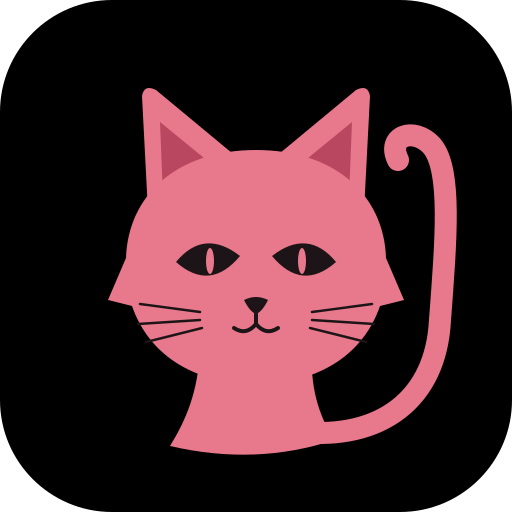

# Pishi



Pishi means cat in Farsi.

A dating app with no swiping. You talk with an AI matchmaker, it builds two profiles for you, and once a week, on the day you choose, it introduces you to two people.

- **Hidden profile**: thirteen traits (social energy, adventure, ambition, family, planning, intellect, spirituality, activity, plus affection, handling disagreements, tidiness, independence and humour, which the matchmaker explores once the first eight are known), each with a confidence, plus how you feel cared for, how fast you like things to move, tags, dealbreakers, values, what you have said you want in a partner, and private notes. Only used for matching. Nobody else ever sees it. You can see it, and correct it with "Not me", which makes the matchmaker ask you directly.
- **Shared profile**: what matches see. The matchmaker *suggests* lines from your answers ("My ideal Sunday", "What makes me laugh", a bio, interests). Nothing appears until you approve it, and contact details are never allowed on it.
- **Two a week**: suggestions come from near you first and only reach as far as both people are happy to go (the matchmaker asks whether long distance is an option; Settings can change it), respect both people's age ranges, who each wants to meet and dealbreakers, and are ranked by mutual fit. You never see the same person twice, or anyone who already passed on you.
- **It keeps learning**: when you pass, the matchmaker asks why straight away (no spark, lives too different, age, distance, a thin profile, or something else) and follows up on the reason: which part of life felt different, what does spark it for you, or whether to set an age limit or stay near you. Limits it learns this way show on your hidden profile and can be removed. When you like someone it asks what caught your eye. The answers update the hidden profile's partner preferences, which changes who you meet next week. Liking someone also nudges preferences toward them.

- **After the match** (round 4, from a comparison with Hinge, Coffee Meets Bagel, Tinder, OkCupid and Bumble): like one line or photo with a note, which the other person sees on your card and which opens the conversation; opening questions a match can answer; "Did you meet?" a week on, which privately teaches matching what works in person; your next two wait until you answer the people waiting on you or close those conversations kindly; first-date ideas from shared interests; and Share Date, which emails a trusted contact your plans and checks you got home safe.

Also: photos (private until a match by default), live messaging with read receipts and icebreakers, in-app and email notifications, email confirmation and password reset, pause, data export, abuse filtering, reporting and a moderator page. See IMPROVEMENTS.md for the full list.

## Run it

Needs Node 20 or newer. Or with Docker: `docker build -t pishi . && docker run -p 3000:3000 -v pishi:/data pishi`.

```sh
npm install
npm start            # http://localhost:3000
```

On first start it creates 64 demo people (London, Berlin, New York and Toronto), labelled "demo profile", so you can try the whole flow alone. Set `PISHI_SEED=0` to skip them.

### The matchmaker

- With `ANTHROPIC_API_KEY` set, the matchmaker uses Claude (`claude-opus-5-5` by default, override with `PISHI_MODEL`). Claude reads each answer, returns structured updates (traits, preferences, tags, interests, a suggested shared line, a private note, a bio draft) through a strict JSON schema, and phrases the next question.
- Without a key, or if a Claude call fails, a deterministic offline matchmaker does the same job with a keyword analyser. `PISHI_AGENT=offline` forces it.
- Either way, the app (not the model) decides what to ask next, so coverage of every trait, the weekly rhythm and the privacy rules stay predictable.

### Pishi Plus: looks

With Pishi Plus, the matchmaker also learns which looks someone goes for. Claude vision describes each uploaded photo once, in a fixed list of style words (hair, glasses, beard, style of dress, tattoos, expression, setting; see `src/looks.js`). There are no words for ethnicity, skin colour, body shape or size, age or attractiveness, so none can be recorded. When a Plus member likes or passes on someone whose photos they could see, the words in those photos are counted in their matching signals, which are never shown in the app. After four such decisions they nudge the ranking a little (at most 0.06). Without `ANTHROPIC_API_KEY` photos are not described and looks play no part.

There is no billing yet: a moderator sets the plan with `POST /api/admin/users/:id/plan` (`{"plan": "plus"}` or `"free"`), or `PISHI_PLUS_ALL=1` gives everyone Plus.

### Other settings

| Variable | Default | Meaning |
|---|---|---|
| `PORT` | `3000` | HTTP port |
| `PISHI_DB` | `data/db.json` | Where data is stored (a single JSON file, written atomically) |
| `PISHI_PHOTOS` | `data/photos` | Where uploaded photos are kept |
| `PISHI_OUTBOX` | `data/outbox` | Every outgoing email is also saved here as JSON |
| `PISHI_MAIL_WEBHOOK` | | URL that receives each email as a JSON POST (`from`, `to`, `subject`, `text`), to connect any email service |
| `PISHI_BASE_URL` | `http://localhost:PORT` | Used for links in emails |
| `ADMIN_EMAILS` | | Comma-separated emails that can open the moderator page (You > Settings > Moderation) |
| `PISHI_SEED` | `1` | `0` skips the demo people |
| `PISHI_PLUS_ALL` | | `1` gives everyone Pishi Plus (looks from photos) |
| `PISHI_LOG` | | `1` logs each request (ids masked) |
| `NODE_ENV=production` | | Marks the session cookie `Secure` (use behind HTTPS) |

Backups of the data file are written daily next to it (last 7 kept).

## Tests

```sh
npm test             # 124 unit and API tests
npm run test:e2e     # 2 browser tests (need Playwright with Chromium installed)
node scripts/screenshots.mjs out/   # screenshots of every screen, light and dark
node scripts/turns-to-ready.mjs -v  # how many answers until matching unlocks
```

## Layout

```
src/
  server.js        starts the HTTP server
  app.js           wires services together, serves the API and static files (no framework)
  http.js          tiny router, body parsing, rate limits
  routes/          one file per area: account, chat, profile, week, matches, notifications, admin
  events.js        live updates (server-sent events)
  mailer.js        outgoing email (outbox folder and/or webhook)
  photos.js        photo checks and storage
  moderation.js    abuse filter
  social.js        matches, check-ins, icebreakers, date ideas, demo replies
  dates.js         "did you meet?" answers and what they teach matching
  turns.js         whose turn it is, closing kindly, reminders
  safety.js        Share Date: plans for a trusted contact, the home-safe check
  feedback.js      tips on lines people write themselves
  scheduler.js     weekly picks, check-ins, reminders, date safety checks, backups
  config.js        settings from the environment
  agent/
    index.js       the conversation loop: what to ask next, applying answers
    questions.js   the question bank (open questions and quick replies)
    analyze.js     offline answer analysis
    mock.js        offline matchmaker
    claude.js      Claude matchmaker (structured outputs, falls back to offline)
    vision.js      Claude vision: describes profile photos in style words (Plus)
  profile.js       hidden/shared profile rules, what is public
  matching.js      eligibility, fit, weekly picks
  traits.js, clock.js, db.js, auth.js, seed.js
public/            the web app (plain JS modules in public/js, no build step; installable)
test/              unit, API and browser tests
IMPROVEMENTS.md    every improvement and how each was checked
```

## Privacy and safety

- Public profile = only approved lines. The API never returns another person's hidden profile, score, email or notes (tested).
- Contact details are filtered from suggestions and rejected on edits.
- Under-18s are stopped at the age question.
- Unmatch and report; reported or unmatched pairs are never suggested again. "I did not feel safe" after a date is a report too.
- What someone says about a person they met is filed under a one-way key, never shown to that person (their export only counts how many answered), and deleted with the account of whoever said it.
- Share Date emails go only to a contact the person set, need a confirmed email, are limited to three a day, never go about demo profiles, and say plainly that Pishi does not know where anyone is or call emergency services.
- Delete account removes both profiles, conversations, matches and messages.
- Photo verification: a live selfie in a random pose (from a list of seven, valid for 10 minutes, one selfie per pose, five tries a day) is compared with the profile photos. With `ANTHROPIC_API_KEY` set, Claude checks that it is a live photo, shows the pose and is the same person; a clear match verifies at once, an unsure answer or a failed call goes to a moderator (Moderation page), and a mismatch can be sent to a moderator once. Without a key every selfie goes to a moderator. The Verified badge shows only while every profile photo has been checked; a photo added later is compared with the stored selfie the same way. The selfie is never on the profile, only moderators reviewing it can open it, and it is deleted with the verification or the account.
- Passwords are hashed with scrypt, sessions are HttpOnly cookies, writes must be JSON (CSRF), and sign-in, chat and writes are rate limited.

## Not built yet

Phone push notifications, photo moderation (beyond verification), and a real database for more than a few thousand people. The Claude matchmaker and selfie check have not been run against the live API in development (no key was available); the offline matchmaker is fully tested.
